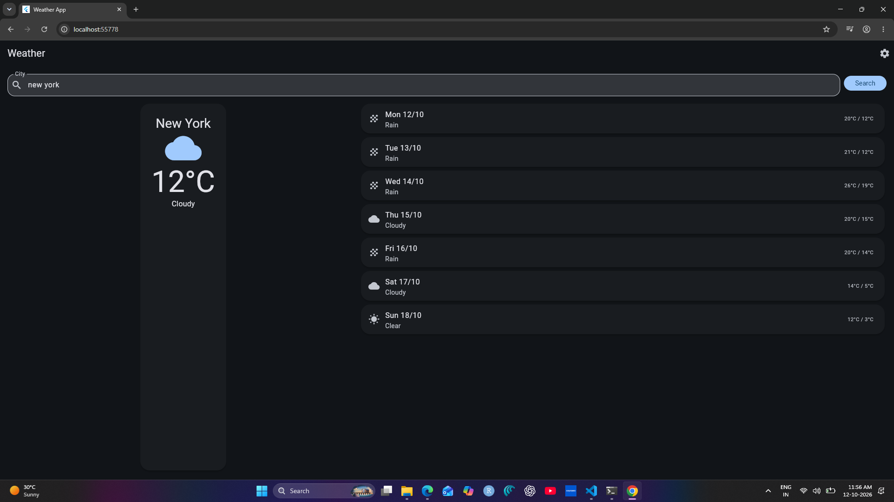
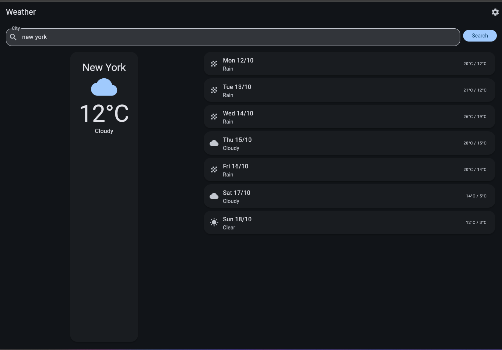
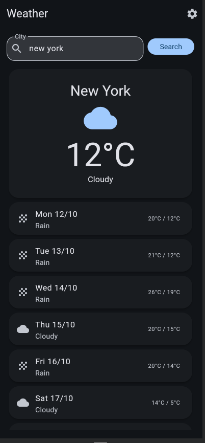
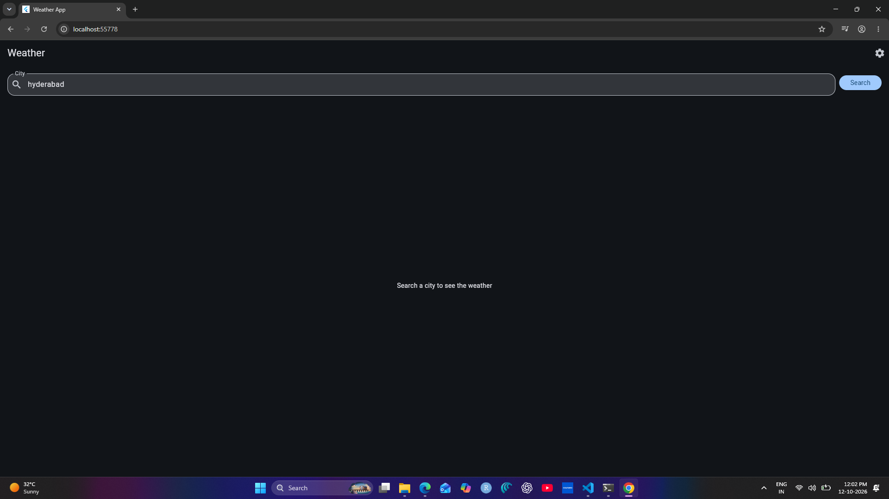
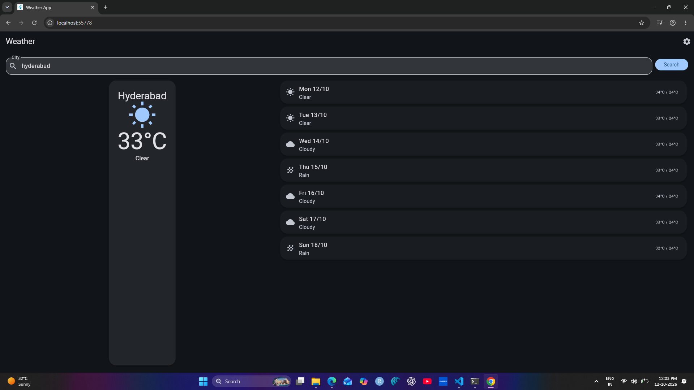
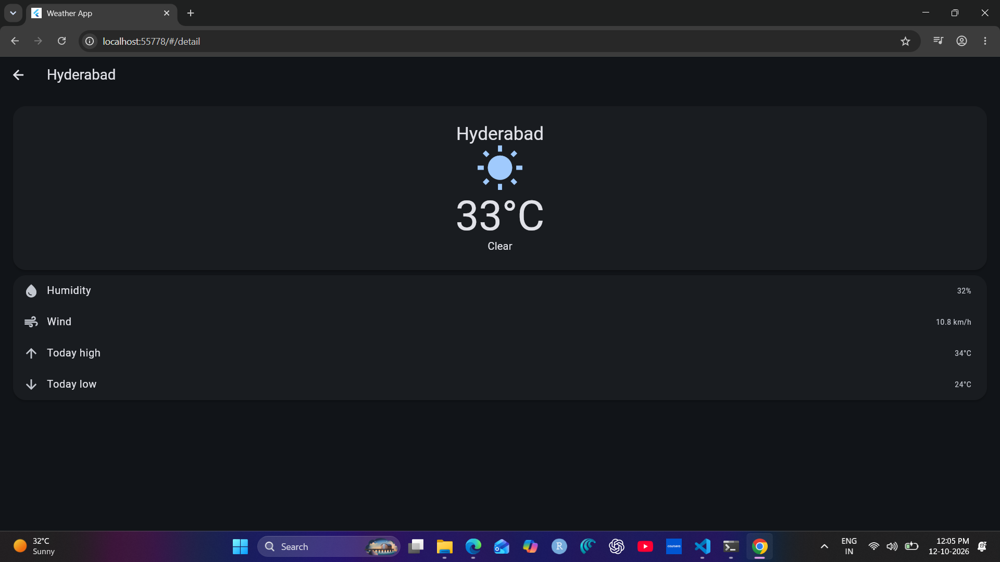
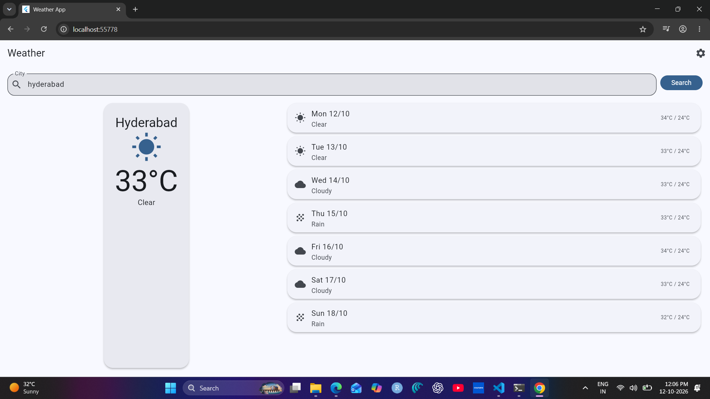
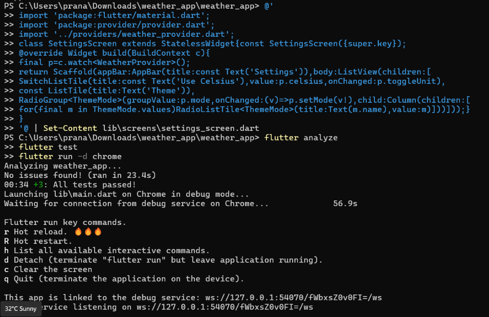

# Weather App (CS506PC – UI Design, Flutter Lab)

A Flutter weather app: search any city, see current conditions and a 7-day forecast, switch units and theme. Data comes from the free [Open-Meteo](https://open-meteo.com) API (no API key needed).

## Features
- City search with form validation
- Current temperature, humidity, wind and condition icon
- 7-day forecast
- Celsius / Fahrenheit toggle and Light / Dark / System theme
- Responsive layout for phone, tablet and laptop
- Animated icon, fade-in temperature, animated content switching, Hero and slide page transitions

## Syllabus Concept Mapping

| # | Concept | Where it is used | File |
|---|---------|------------------|------|
| 1 | Widgets & layouts | Scaffold, Column, Row, ListView, Card, ListTile, Expanded | `lib/screens/*.dart` |
| 2 | Responsive design | `LayoutBuilder` switches between side-by-side and stacked layout | `lib/screens/home_screen.dart` |
| 3 | Navigation | Named routes and custom slide transition | `lib/main.dart` |
| 4 | State management | Provider + ChangeNotifier | `lib/providers/weather_provider.dart` |
| 5 | Custom widgets | CurrentCard, ForecastTile, WeatherIcon | `lib/widgets/` |
| 6 | Themes & styling | Material 3 light and dark themes | `lib/theme/app_theme.dart` |
| 7 | Forms & validation | Form, TextFormField, validator | `lib/screens/home_screen.dart` |
| 8 | Animations | Implicit, explicit, Hero and page transitions | `lib/widgets/`, `lib/main.dart` |
| 9 | REST API integration | HTTP GET, JSON parsing, error handling | `lib/services/`, `lib/models/` |
| 10 | Testing & debugging | Unit test with mock client, widget tests, `flutter analyze` | `test/weather_test.dart` |

## Code Evidence and Explanation

### 1. Widgets and layouts
The home screen is built from `Scaffold`, `AppBar`, `Column`, `Padding` and `Expanded`. Forecast days are `Card` + `ListTile` widgets.
```dart
return Scaffold(
  appBar: AppBar(title: const Text('Weather'), actions: [
    IconButton(icon: const Icon(Icons.settings),
      onPressed: () => Navigator.pushNamed(c, '/settings'))]),
  body: Padding(padding: const EdgeInsets.all(16),
    child: Column(children: [_form(), const SizedBox(height: 12), Expanded(child: ...)])));
```

### 2. Responsive design
`LayoutBuilder` reads the available width. Above 700 px (tablet and laptop) the current card sits beside the forecast. Below 700 px (phone) everything stacks in one list.
```dart
body = LayoutBuilder(builder: (_, box) => box.maxWidth > 700
  ? Row(children: [
      Expanded(flex: 2, child: Center(child: cur)),
      Expanded(flex: 3, child: ListView(children: days))])
  : ListView(children: [cur, ...days]));
```

### 3. Navigation
Named routes connect Home, Detail and Settings. `onGenerateRoute` adds a slide-in transition for the pushed screens.
```dart
Route _route(RouteSettings s) {
  final page = switch (s.name) {
    '/detail' => const DetailScreen(),
    '/settings' => const SettingsScreen(),
    _ => const HomeScreen()};
  if (s.name == '/') return MaterialPageRoute(settings: s, builder: (_) => page);
  return PageRouteBuilder(settings: s, pageBuilder: (_, __, ___) => page,
    transitionsBuilder: (_, a, __, child) => SlideTransition(
      position: Tween(begin: const Offset(1, 0), end: Offset.zero).animate(
        CurvedAnimation(parent: a, curve: Curves.easeOut)), child: child));
}
```

### 4. State management
`WeatherProvider` stores loading, error, weather data, unit and theme mode. Widgets call it with `context.read` and rebuild with `context.watch`.
```dart
class WeatherProvider extends ChangeNotifier {
  Weather? weather; String? error; bool loading = false, celsius = true;
  ThemeMode mode = ThemeMode.system;
  Future<void> search(String city) async {
    loading = true; error = null; notifyListeners();
    try { weather = await service.fetch(city); }
    on Exception catch (e) { error = e.toString().replaceFirst('Exception: ', ''); }
    loading = false; notifyListeners();
  }
  void toggleUnit(bool v) { celsius = v; notifyListeners(); }
}
```

### 5. Custom widgets
Reusable widgets keep the screens small: `CurrentCard` (current weather), `ForecastTile` (one forecast day) and `WeatherIcon` (animated icon).
```dart
class ForecastTile extends StatelessWidget {
  const ForecastTile(this.d, {super.key});
  final Day d;
  @override Widget build(BuildContext c) {
    final p = c.watch<WeatherProvider>();
    return Card(child: ListTile(leading: Icon(iconFor(d.code)),
      title: Text('${_n[d.date.weekday - 1]} ${d.date.day}/${d.date.month}'),
      subtitle: Text(describe(d.code)),
      trailing: Text('${p.t(d.max)} / ${p.t(d.min)}')));
  }
}
```

### 6. Themes and styling
One seed colour generates matching light and dark colour schemes. Card shape and input style are set once in the theme. The user chooses the mode on the Settings screen.
```dart
ThemeData _build(Brightness b) {
  final s = ColorScheme.fromSeed(seedColor: Colors.blue, brightness: b);
  return ThemeData(useMaterial3: true, colorScheme: s,
    cardTheme: CardThemeData(elevation: 3,
      shape: RoundedRectangleBorder(borderRadius: BorderRadius.circular(20))),
    inputDecorationTheme: InputDecorationTheme(
      border: OutlineInputBorder(borderRadius: BorderRadius.circular(16)), filled: true));
}
```

### 7. Forms and validation
The city field rejects empty input, one-character input and names with digits or symbols before any network call is made.
```dart
validator: (v) {
  final s = v?.trim() ?? '';
  if (s.isEmpty) return 'Enter a city';
  if (s.length < 2) return 'Too short';
  if (!RegExp(r"^[\p{L}\s.'-]+$", unicode: true).hasMatch(s)) return 'Letters only';
  return null;
}
```

### 8. Animations
- **Explicit:** `AnimationController` + `ScaleTransition` makes the weather icon pulse.
- **Implicit:** `TweenAnimationBuilder` fades in the temperature; `AnimatedSwitcher` cross-fades between loading, error and result states.
- **Hero:** the current-weather card flies to the detail screen.
- **Page transition:** slide-in route (see Navigation).
```dart
late final AnimationController _a = AnimationController(
  vsync: this, duration: const Duration(seconds: 2))..repeat(reverse: true);
late final Animation<double> _s = Tween(begin: 0.9, end: 1.1)
  .animate(CurvedAnimation(parent: _a, curve: Curves.easeInOut));
// build: ScaleTransition(scale: _s, child: Icon(...))
```

### 9. REST API integration
The city name is converted to coordinates by the geocoding API, then the forecast API returns current and daily data. Errors (unknown city, server error, no internet) are shown to the user.
```dart
final g = await _c.get(Uri.https('geocoding-api.open-meteo.com', '/v1/search',
  {'name': city, 'count': '1'}));
final r = jsonDecode(g.body)['results'];
if (r == null) throw Exception('City not found');
final w = await _c.get(Uri.https('api.open-meteo.com', '/v1/forecast', {
  'latitude': '${r[0]['latitude']}', 'longitude': '${r[0]['longitude']}',
  'current': 'temperature_2m,relative_humidity_2m,wind_speed_10m,weather_code',
  'daily': 'weather_code,temperature_2m_max,temperature_2m_min', 'timezone': 'auto'}));
return Weather.fromJson(r[0]['name'], jsonDecode(w.body));
```

### 10. Testing and debugging
A mock HTTP client tests API parsing without the internet. Widget tests check form validation, the search flow and navigation to Settings. `flutter analyze` reports no issues.
```dart
test('service parses API response', () async {
  final w = await fake().fetch('Delhi');
  expect(w.city, 'Delhi'); expect(w.days.length, 2); expect(w.humidity, 50);
});
testWidgets('empty city shows validation error', (t) async {
  await t.pumpWidget(WeatherApp(service: fake()));
  await t.tap(find.text('Search')); await t.pump();
  expect(find.text('Enter a city'), findsOneWidget);
});
```

## Screenshots

| Concept | Screenshot |
|---------|-----------|
| Laptop / web view |  |
| Tablet view |  |
| Mobile view |  |
| Form validation |  |
| API result |  |
| Navigation |  |
| Dark theme |  |
| Tests passing |  |

## How to Run
```bash
git clone https://github.com/kshitinemmaniwar27/weather_app.git
cd weather_app
flutter pub get
flutter run -d chrome
flutter test
flutter analyze
```

## Project Structure
```
lib/
  main.dart                       app and routes
  models/weather.dart
  services/weather_service.dart
  providers/weather_provider.dart
  theme/app_theme.dart
  widgets/                        weather_icon, current_card, forecast_tile
  screens/                        home, detail, settings
test/weather_test.dart
screenshots/
```
